# Mídia Dublada: instalação automatizada de serviços de download de mídia

**Automação de download e gerenciamento de mídia, dublada ou legendada em português.**

**Sua própria "Netflix" em casa, montada por um único instalador.**

Você pede um filme ou uma série pelo celular, ele é procurado e baixado sozinho do jeito que você escolheu (**só dublado**, **dublado ou legendado**, ou **áudio original com legenda em português**) e **na qualidade que você quer** (720p, 1080p ou 4K). O filme é organizado com nome e capa em português e aparece pronto para assistir na TV. Música também.

<p align="center">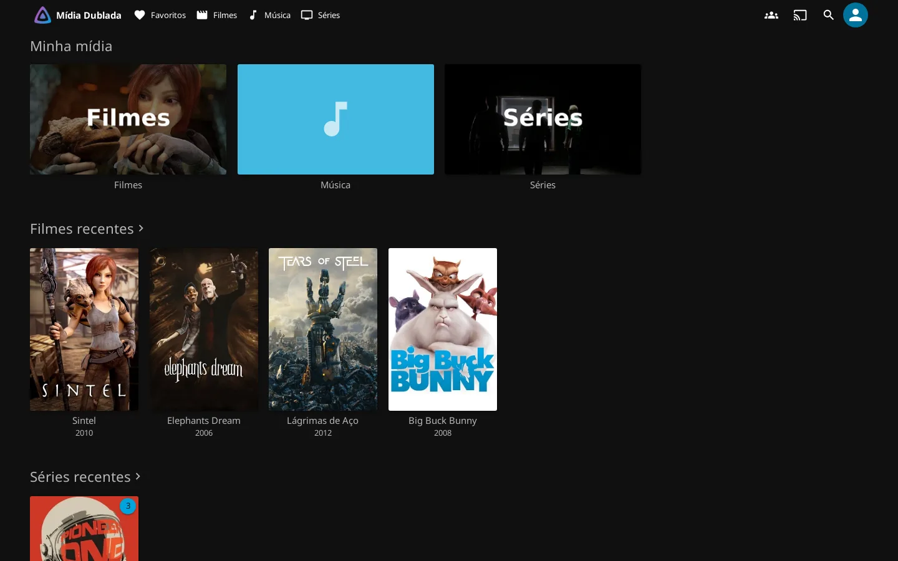</p>

> ⚠️ **Testado só com o Jellyfin.** Toda a automação (bibliotecas, avisos de download novo, login no Seerr) foi feita e testada com o **Jellyfin**. Plex e Emby **não foram testados** e não são configurados pelo instalador.

Não precisa saber Docker nem configurar nada à mão: o instalador faz as perguntas em português e liga todos os programas entre si.

```
  Você pede no          procura só          baixa             organiza e          você assiste
  📱 Seerr      ───▶   🔎 Radarr/Sonarr ───▶ ⬇ qBittorrent ───▶ 📁 renomeia em PT ───▶ 📺 Jellyfin
                     (filtro de idioma)                    💬 Bazarr (legendas)   🌍 fora de casa: Tailscale
```

| Programa | Para que serve |
|---|---|
| **Jellyfin** | Onde você assiste e ouve (TV, celular, navegador) |
| **Seerr** | Onde a família pede filmes e séries |
| **Radarr** / **Sonarr** / **Lidarr** | Procuram e organizam filmes / séries / música |
| **Prowlarr** | Guarda as fontes de busca (indexadores) e repassa para os outros |
| **qBittorrent** | Faz os downloads |
| **Bazarr** (se escolher legendado) | Baixa legendas em português sozinho |
| **FlareSolverr** | Ajuda com fontes protegidas pelo Cloudflare |
| **Tailscale** (opcional) | Acesso fora de casa, sem abrir portas no roteador |

---

## ✨ O que já vem configurado

- **Filtro de idioma** no Radarr e no Sonarr, testado na prática: só dublado, dublado ou legendado, ou legendado (veja [como funciona](#-como-o-filtro-de-idioma-funciona)).
- **Qualidade à sua escolha**: até 720p, até 1080p ou até 4K.
- Nomes de pastas e arquivos **em português** (`Batman - O Cavaleiro das Trevas (2008)`), interfaces em português.
- Jellyfin com bibliotecas **Filmes, Séries e Música** criadas e informações em português. O áudio em português é o preferido; no modo legendado, toca o áudio original com legenda em português.
- No modo com legenda, o **Bazarr** já vem ligado ao Radarr e ao Sonarr, buscando legendas PT-BR.
- Seerr ligado ao Jellyfin, ao Radarr e ao Sonarr: dá para entrar com o mesmo usuário do Jellyfin.
- Cada download novo **avisa o Jellyfin**, que o mostra em poucos segundos.
- qBittorrent com pastas e categorias prontas; **não baixa `.exe`, `.bat` e afins**, comuns em torrent falso.
- Limite de compartilhamento: quando é atingido, o torrent sai sozinho da lista.
- Lidarr só com **álbuns e EPs de estúdio** (sem singles, coletâneas ou shows ao vivo).
- **Busca de lançamentos**: a versão dublada costuma sair dias depois da estreia; episódios e filmes recentes que faltam são procurados de novo a cada 6 horas.
- **Apagou no Jellyfin, não volta**: o que você apaga não é baixado de novo, e some também do Radarr/Sonarr.
- **Manutenção automática** a cada 5 minutos ([detalhes](#-manutenção-automática)).
- Mesmo usuário e senha em todos os painéis, e todos pedem login.

## 📋 O que você precisa

- Um computador com **Linux** ligado o tempo todo: mini PC, PC velho, servidor, Raspberry Pi 4/5 etc.
  Funciona em Debian, Ubuntu, Raspberry Pi OS, OpenMediaVault e em VM/LXC do Proxmox.
- Um disco com espaço para os filmes (cada filme 1080p ocupa de 2 a 5 GB).
- **4 GB de RAM** ou mais.
- O **Docker** não precisa estar instalado antes: o instalador oferece instalar.

## 🚀 Instalação

Abra o terminal do computador (ou entre por SSH) e copie os comandos abaixo:

```bash
git clone https://github.com/nutersamsu/midia-dublada.git
cd midia-dublada
sudo ./instalar.sh
```

> Sem o `git`? Use `sudo apt install git`, ou baixe o ZIP pelo botão verde **Code › Download ZIP** e descompacte.

O instalador pergunta:

1. **Onde guardar os arquivos.** Ele mostra os discos e o espaço livre de cada um.
2. **Usuário e senha.** São os mesmos para todos os painéis; se você deixar a senha em branco, ele gera uma.
3. **Se quer o Tailscale**, para assistir fora de casa ([saiba mais](#-fora-de-casa-tailscale)).
4. **Idioma:** só dublado, dublado ou legendado, ou áudio original com legenda.
5. **Qualidade máxima:** 720p, 1080p ou 4K.
6. **Se quer compartilhar** um pouco depois de baixar.

Depois ele baixa os programas (cerca de 3 GB na primeira vez), configura tudo e mostra os endereços:

<p align="center">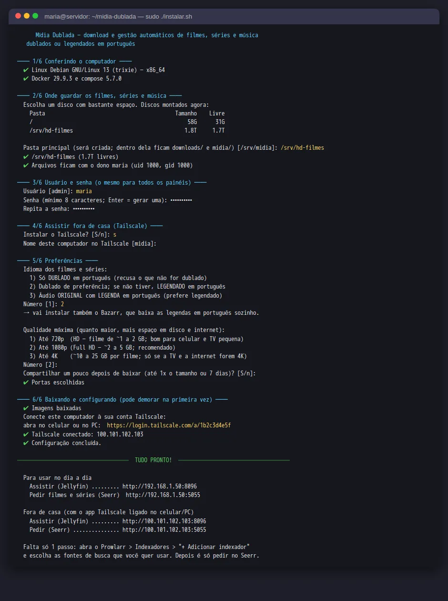</p>

Os endereços também ficam salvos em `LEIA-ME-INSTALACAO.txt`.

## 📸 Como é cada programa

> Telas reais de uma instalação feita por este instalador. Os títulos são filmes livres da Blender Foundation, usados só como exemplo.

| | |
|---|---|
| **Seerr: onde a família pede**<br>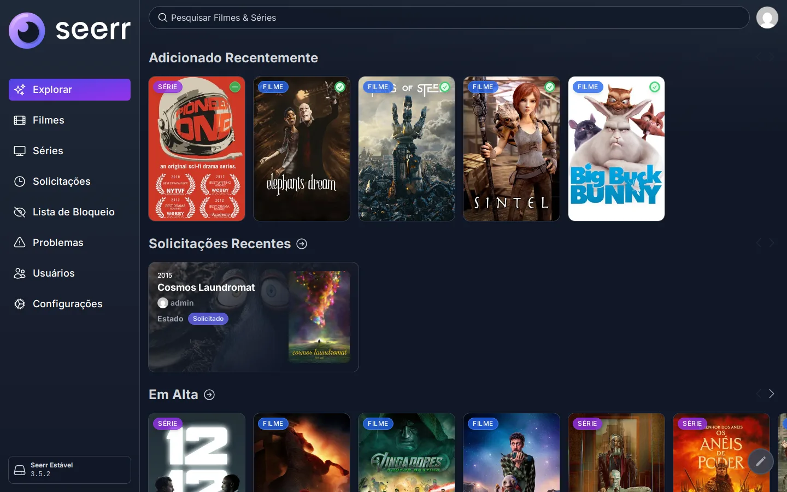 | **Seerr: página do filme, em português**<br>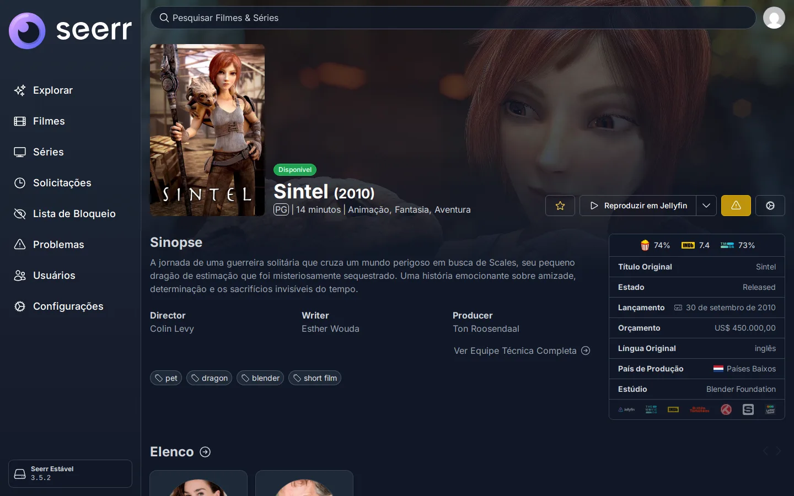 |
| **Jellyfin: onde você assiste**<br> | **Jellyfin: áudio em português, sinopse em português**<br>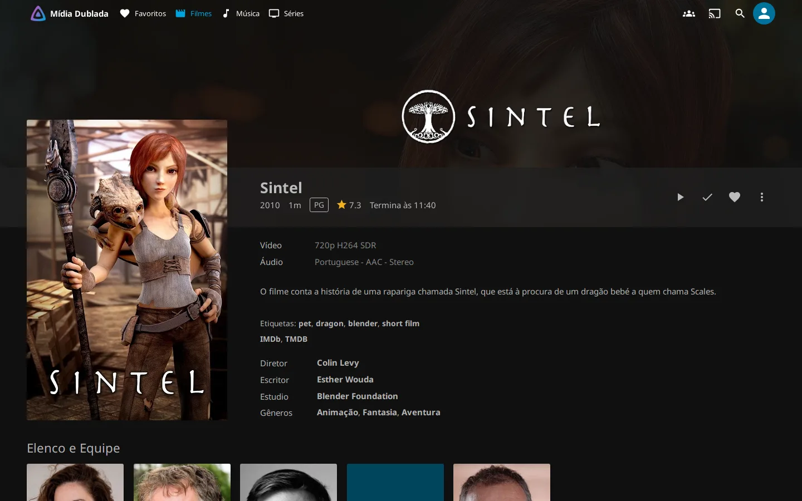 |
| **Radarr: filmes** (verde = baixado, vermelho = falta)<br>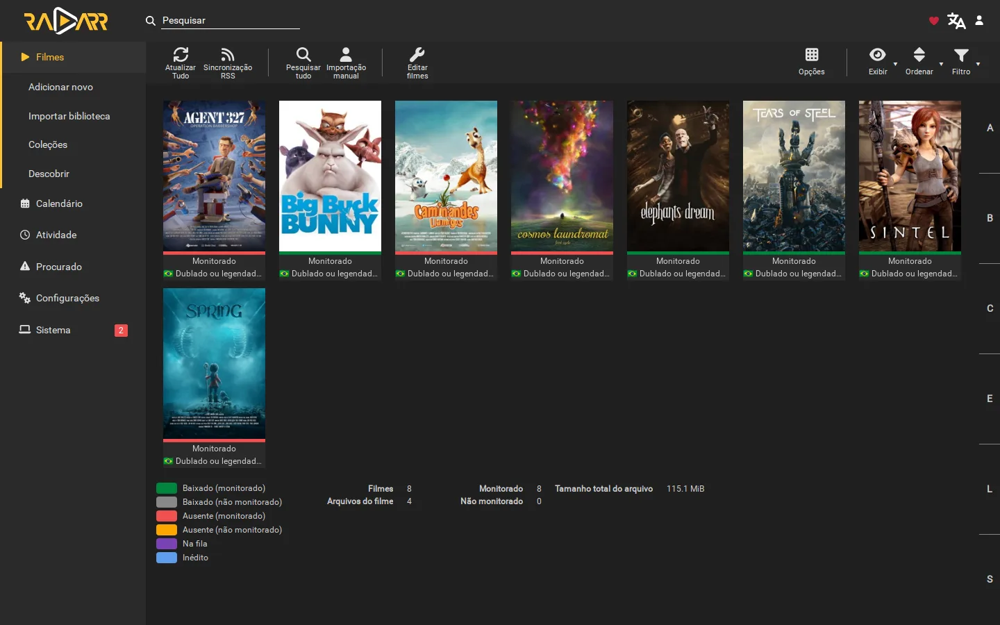 | **Radarr: o perfil criado pelo instalador**<br>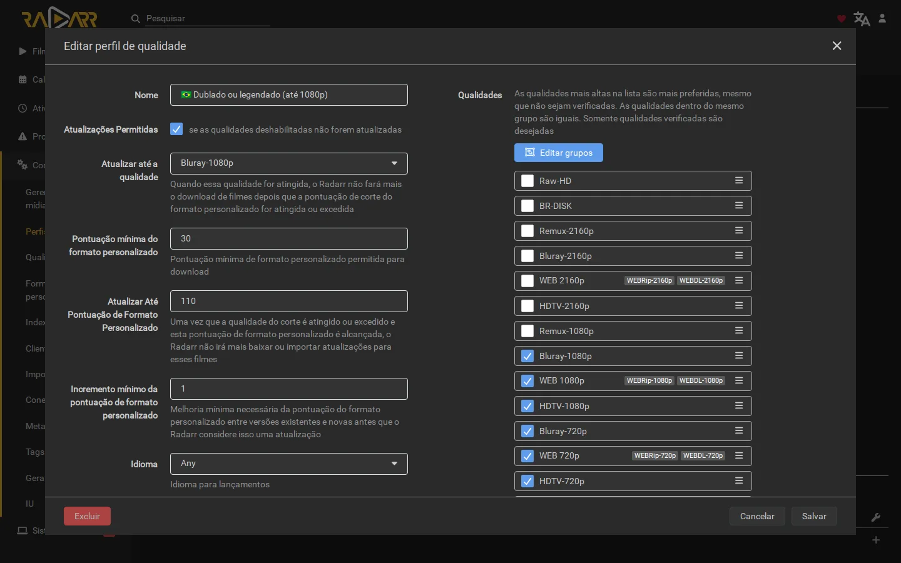 |
| **Sonarr: séries**<br>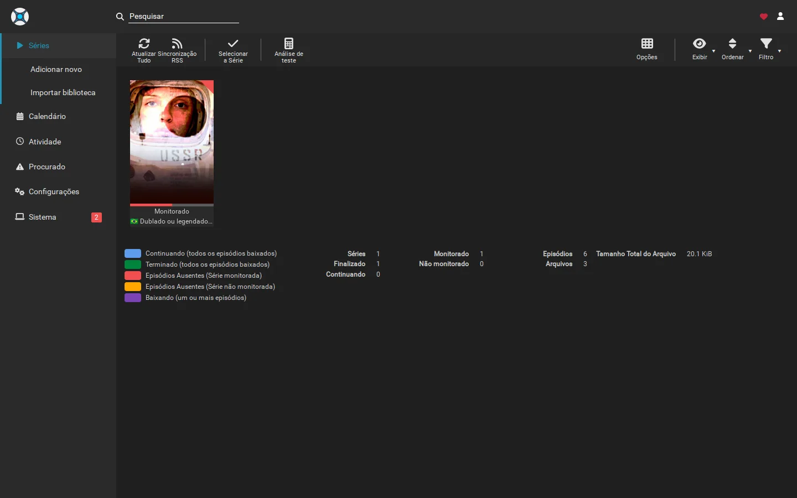 | **Lidarr: música**<br>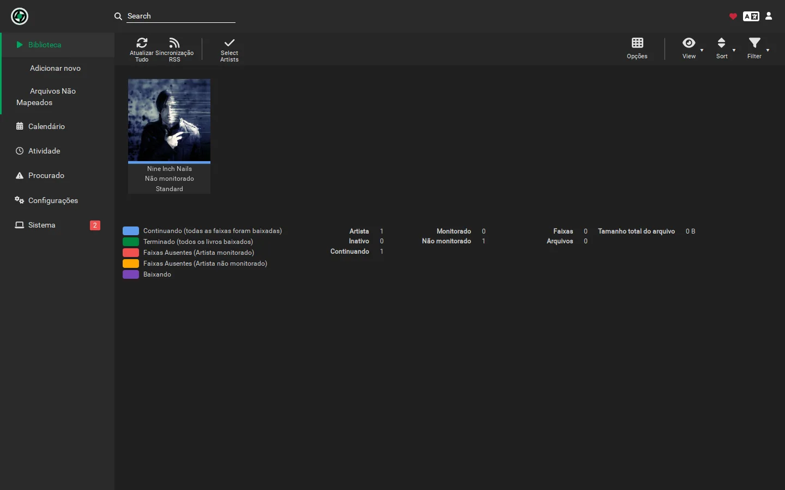 |
| **Prowlarr: onde você adiciona as fontes**<br>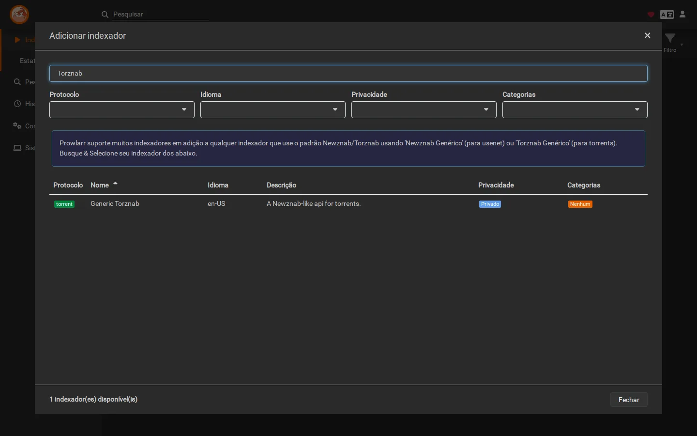 | **Bazarr: legendas PT-BR** (só nos modos com legenda)<br>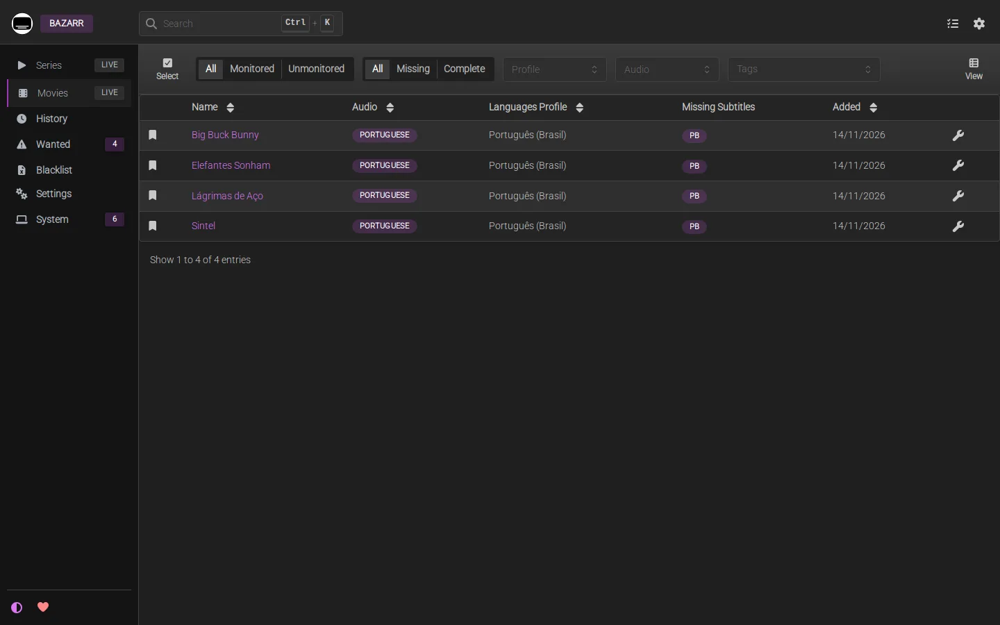 |
| **qBittorrent: os downloads, com categorias prontas**<br>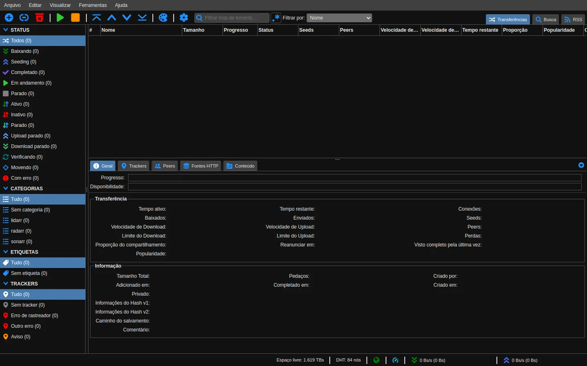 | |

Quase tudo aparece em português. O Bazarr ainda não tem tradução e fica em inglês.

## 👣 Primeiro uso (só 1 passo manual)

### 1. Adicione as fontes de busca no Prowlarr
Por motivos legais, o projeto **não vem com fontes**: cada pessoa escolhe as suas.

1. Abra o **Prowlarr** (`http://SEU-IP:9696`) e entre com seu usuário e senha.
2. Vá em **Indexadores › + Adicionar indexador**.
3. Filtre pelo idioma **pt-BR**, escolha as fontes que você quer usar e clique em **Testar** e depois em **Salvar**.
4. Se o teste falhar com um erro do **Cloudflare**, edite a fonte e coloque a tag **`flaresolverr`**.

As fontes vão sozinhas para o Radarr, o Sonarr e o Lidarr.

### 2. Peça um filme
Abra o **Seerr** (`http://SEU-IP:5055`), entre com o usuário do Jellyfin, procure um filme e clique em **Solicitar**.

### 3. Assista
Quando terminar de baixar, o filme aparece no **Jellyfin** (`http://SEU-IP:8096`). Na TV, instale o app **Jellyfin** (Android TV, Fire TV, Samsung, LG, Roku), ou use o navegador. No celular também tem app.

### Família
Crie um usuário para cada pessoa no **Jellyfin › Painel › Usuários**. Com esse mesmo usuário, a pessoa já consegue pedir no Seerr. Os pedidos de quem não é administrador precisam da sua aprovação no Seerr; para aprovar automaticamente, use **Seerr › Configurações › Usuários › Permissões padrão › Aprovar automaticamente**.

## 🎯 Como o filtro de idioma funciona

Cada versão encontrada ganha pontos conforme o **modo de idioma** que você escolheu. Ela só é baixada se atingir o mínimo.

| Regra | Exemplo no nome | Só dublado | Dublado ou legendado | Legendado |
|---|---|---:|---:|---:|
| Idioma detectado como Português | (o Radarr/Sonarr detecta) | +100 | +100 | 0 |
| Dublado no nome | `Dublado`, `Nacional`, `PT-BR`, `Português` | +100 | +100 | −40 |
| DUAL áudio (original + português) | `DUAL` | +10 | +10 | +50 |
| Legendado no nome | `Legendado`, `LEG` | −1000 | +50 | +100 |
| Legenda fixa na imagem | `HC`, `Hardsub` | −1000 | −20 | −20 |
| Outro idioma no nome | `Hindi`, `Latino`, `Spanish`, `ITA`... | −1000 | −1000 | −1000 |
| **Mínimo para baixar** | | **100** | **30** | **0** |

O que acontece com cada versão:

| Nome da versão | Só dublado | Dublado ou legendado | Legendado |
|---|:---:|:---:|:---:|
| `Filme 2023 1080p BluRay Dublado` | ✅ | ✅ | ❌ sem áudio original |
| `Filme.2023.1080p.WEB-DL.DUAL.PT-BR` | ✅ | ✅ | ✅ |
| `Filme.2023.1080p.Legendado` | ❌ | ✅ | ✅ |
| `Filme.2023.1080p.WEB-DL.DUAL` | ❌ só "DUAL" não garante português | ❌ | ✅ |
| `Filme.2023.1080p.WEB-DL` (original) | ❌ | ❌ | ✅ o Bazarr põe a legenda |
| `Filme.2023.1080p.Hindi.English` | ❌ | ❌ | ❌ |

**Qualidade:** aceita de SD até o máximo escolhido (720p, 1080p ou 4K) e troca por uma versão melhor até chegar nele. Versões Remux, que são gigantes, ficam de fora.

**Para mudar depois:** rode `sudo ./instalar.sh` de novo e escolha outra opção, ou edite `IDIOMA=` e `QUALIDADE=` no `.env` e rode `sudo ./gerenciar.sh reconfigurar`. Para ajustar as regras finas, edite [`configurador/formatos-ptbr.json`](configurador/formatos-ptbr.json).

### Legendas (Bazarr)
Nos modos com legenda, o Bazarr procura legenda em português (Brasil) para tudo o que chega sem áudio em português, usando fontes que não pedem cadastro. Para achar **muito mais** legendas, crie uma conta grátis no [OpenSubtitles.com](https://www.opensubtitles.com) e coloque o usuário e a senha no **Bazarr › Settings › Providers › OpenSubtitles.com**.

## 🔧 Manutenção automática

O container `manutencao` corrige sozinho problemas que apareceram no uso real:

| Problema | O que ela faz |
|---|---|
| Você baixou um filme **à mão** e ele não está no Radarr | Cadastra o filme, se o TMDB der um resultado com o mesmo título e ano, e o Radarr organiza |
| Você baixou uma série à mão com o nome em português | Acha a série (o Sonarr guarda o nome em inglês) e importa os episódios |
| Versão diz "1080p" mas o arquivo é 720p (baixava de novo sem parar) | Bloqueia essa versão; o arquivo continua na biblioteca |
| Radarr travado em "matched to movie by ID" | Importa o arquivo |
| Torrent em "Forçar início" que nunca sai da lista | Tira o forçado para o limite de compartilhamento valer |
| Lidarr procurando centenas de álbuns de uma vez (as fontes bloqueiam) | Procura 1 álbum a cada 10 minutos e ignora shows ao vivo |
| Episódio ou filme novo sem versão dublada no dia da estreia (o RSS não vê de novo) | A cada 6 h procura episódios exibidos nos últimos 30 dias e filmes lançados nos últimos 90 dias que faltam; 1 vez por dia, tudo o que falta |
| Você apagou um filme ou série pelo Jellyfin e ele continua no Radarr/Sonarr | De hora em hora tira do Radarr/Sonarr (sem apagar arquivos). Só quando não está mais no Jellyfin, tem 0 arquivos, foi apagado mesmo (pelo histórico), está desmonitorado e foi adicionado há mais de 24 h. Se o Jellyfin estiver fora ou a biblioteca quase vazia, não faz nada; no máximo 3 por vez |

O Radarr e o Sonarr também já vêm com **"desmonitorar o que foi apagado"** ligado: episódio ou filme que você apaga não é baixado de novo.

Se aparecer um caso ambíguo, ela não mexe em nada; só registra no log: `sudo ./gerenciar.sh logs manutencao`.

Para desligar alguma parte, mude para `nao` no `.env` e rode `sudo ./gerenciar.sh reconfigurar`: `BUSCA_PERIODICA` (busca de lançamentos), `LIMPEZA_JELLYFIN` (limpeza pelo Jellyfin), `LIDARR_BUSCA_ESPACADA` e `LIDARR_SEM_AO_VIVO`.

### Baixando à mão no qBittorrent
Escolha a **categoria `radarr`** para filme ou **`sonarr`** para série. O resto é automático: cadastro, nome em português, pasta certa e aviso ao Jellyfin.

## 🌍 Fora de casa (Tailscale)

O [Tailscale](https://tailscale.com) liga este computador aos seus celulares, notebooks e TVs numa rede privada. Fora de casa, você abre o Jellyfin e o Seerr como se estivesse no Wi-Fi de casa, **sem abrir portas no roteador**. É grátis para uso pessoal.

1. Responda **sim** quando o instalador perguntar.
2. Ele mostra um link `https://login.tailscale.com/...`. Abra no celular ou no PC e entre com Google, Microsoft ou Apple; a conta é criada na hora.
3. Instale o app **Tailscale** no celular ou no notebook e entre com a mesma conta.
4. Fora de casa, com o Tailscale ligado, use os endereços `http://100.x.y.z:8096` que o instalador mostrou.

Se o computador já tiver o Tailscale instalado, o instalador percebe e não instala outro.
Conferir ou refazer o login: `sudo ./gerenciar.sh tailscale`.

### VPN paga para os downloads (avançado, por sua conta)
O projeto **não configura** VPN paga. Quem quiser que os torrents saiam por uma VPN, como Mullvad, ProtonVPN ou AirVPN, pode usar o arquivo pronto `compose/qbittorrent-vpn.yml` ([Gluetun](https://github.com/qdm12/gluetun-wiki/tree/main/setup/providers)):

1. No `.env`, troque `compose/qbittorrent.yml` por `compose/qbittorrent-vpn.yml` na linha `COMPOSE_FILE`.
2. Preencha as linhas `VPN_...` com os dados da sua VPN.
3. Rode `sudo ./gerenciar.sh reconfigurar` e confira o IP com `sudo ./gerenciar.sh vpn`.

Se a VPN cair, os downloads param, em vez de sair pelo seu IP.

## 🛠 Dia a dia

```bash
sudo ./gerenciar.sh            # menu
sudo ./gerenciar.sh status     # o que está rodando
sudo ./gerenciar.sh atualizar  # baixa versões novas de tudo (mantém as configurações)
sudo ./gerenciar.sh logs radarr
sudo ./gerenciar.sh backup     # copia as configurações (não os filmes)
sudo ./gerenciar.sh reconfigurar
```

Mudou de ideia sobre alguma resposta? É só rodar `sudo ./instalar.sh` de novo. Ele usa as respostas anteriores como padrão e **não apaga nada**.

### Onde fica cada coisa

```
(pasta do projeto)        (onde você rodou o instalador)
├── .env                   suas respostas e a senha (não compartilhe)
└── config/                configurações e bancos de dados de cada programa

PASTA ESCOLHIDA/           (ex.: /srv/midia)
├── downloads/             torrents baixando e recém-baixados
└── midia/
    ├── filmes/            ← o Jellyfin lê daqui
    ├── series/
    └── musica/
```

Já tem filmes? Copie as pastas para `midia/filmes`. Depois, no Radarr, use **Filmes › Importar biblioteca** para ele reconhecer.

## ❓ Problemas comuns

<details><summary><b>Pede um filme e nada baixa</b></summary>

- Confira se há fontes no Prowlarr e se o teste delas passa.
- No Radarr, abra o filme, clique em **Busca interativa** e passe o mouse no ⚠ das versões recusadas para ver o motivo. O mais comum é não existir versão dublada: só "DUAL" ou legendada.
</details>

<details><summary><b>Baixou mas não aparece no Jellyfin</b></summary>

Veja a aba **Atividade › Fila** do Radarr ou Sonarr. Um ⚠ ali mostra por que o arquivo não foi importado. No Jellyfin, **Painel › Bibliotecas › Escanear** força uma nova leitura.
</details>

<details><summary><b>"Porta já em uso" ou quero mudar uma porta</b></summary>

Na primeira instalação, o instalador já escolhe sozinho uma porta livre. Para mudar depois, edite a linha `PORTA_...` no `.env` e rode `sudo ./gerenciar.sh reconfigurar`.
</details>

<details><summary><b>Esqueci a senha</b></summary>

Ela está no arquivo `.env` (`sudo cat .env | grep SENHA`).
</details>

<details><summary><b>Acesso fora de casa</b></summary>

Use o [Tailscale](#-fora-de-casa-tailscale), que o instalador já oferece. Se preferir um domínio com HTTPS (Nginx Proxy Manager, Caddy...), aponte só para o Jellyfin e o Seerr. **Não exponha** o Radarr, o Sonarr, o Prowlarr e o qBittorrent na internet.
</details>

<details><summary><b>Usar a placa de vídeo no Jellyfin</b></summary>

Se o computador tiver `/dev/dri` (Intel ou AMD), o instalador pergunta se quer usar. Depois ative em **Jellyfin › Painel › Reprodução › Transcodificação**: Intel QuickSync (QSV) para Intel ou VA-API para AMD.
</details>

## ⚖️ Aviso

Este projeto só **configura programas livres e conhecidos**. Ele **não inclui nem indica** fontes de conteúdo. Você é responsável pelo que baixa: respeite os direitos autorais e as leis do seu país.

## 🙏 Créditos

Feito em cima de projetos incríveis: [Jellyfin](https://jellyfin.org), [Seerr](https://github.com/seerr-team/seerr), [Radarr](https://radarr.video), [Sonarr](https://sonarr.tv), [Lidarr](https://lidarr.audio), [Prowlarr](https://prowlarr.com), [qBittorrent](https://www.qbittorrent.org), [FlareSolverr](https://github.com/FlareSolverr/FlareSolverr), [Gluetun](https://github.com/qdm12/gluetun) e as imagens da [LinuxServer.io](https://www.linuxserver.io).

Licença [MIT](LICENSE).
